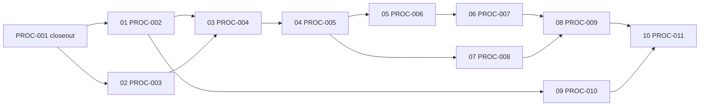

# Procurement Service — Sprint Plan

This folder is the working plan for the remaining Procurement slices. Each sprint
gets its own directory with a brief, task checklist, acceptance criteria, and an
evidence template. The current sprint also gets a detailed runbook.

- Scope source: [`docs/scope/scope.md`](../../../../../docs/scope/scope.md)
- Earlier high-level plan: [`docs/plans/procurement-delivery-plan.md`](../../../../../docs/plans/procurement-delivery-plan.md)
- Service README: [`README.md`](../../README.md)

## Status

| # | Sprint | PROC | Status | Depends on |
|---|---|---|---|---|
| — | [Foundation closeout](./proc-001-evidence.md) | PROC-001 | done | — |
| 01 | [Persistence and schema](./01-proc-002-persistence/README.md) | PROC-002 | done | PROC-001 |
| 02 | [Authorization boundary](./02-proc-003-authorization/README.md) | PROC-003 | planned | PROC-001 |
| 03 | [Draft purchase orders](./03-proc-004-draft-orders/README.md) | PROC-004 | planned | PROC-002, PROC-003 |
| 04 | [Purchase order lifecycle](./04-proc-005-lifecycle/README.md) | PROC-005 | planned | PROC-004 |
| 05 | [Reference validation](./05-proc-006-reference-validation/README.md) | PROC-006 | planned | PROC-005 |
| 06 | [Goods receiving](./06-proc-007-goods-receiving/README.md) | PROC-007 | planned | PROC-006 |
| 07 | [Search and receipt history](./07-proc-008-search-history/README.md) | PROC-008 | planned | PROC-005 |
| 08 | [Events and recovery](./08-proc-009-events-recovery/README.md) | PROC-009 | planned | PROC-007, PROC-008 |
| 09 | [Runtime operations](./09-proc-010-runtime-ops/README.md) | PROC-010 | planned | PROC-002 |
| 10 | [Integration verification](./10-proc-011-integration/README.md) | PROC-011 | planned | all |

Status values: `planned`, `in progress`, `review`, `done`.

## How to run a sprint

1. Read the sprint `README.md`, `acceptance.md`, and the shared
   [`decisions.md`](./decisions.md).
2. Confirm every open decision that sprint depends on. Record the answer in
   `decisions.md` with the date.
3. Create the branch:
   `git switch -c feat/<service-name>/<feature-name>`
4. If the sprint has no `runbook.md`, copy
   [`runbook-template.md`](./runbook-template.md) and fill it in before coding.
5. Work through `tasks.md` in order. Keep the service buildable after every task.
6. Run the sprint gates and record the output in `evidence.md`.
7. Review the diff against `acceptance.md`; fix gaps before committing.
8. Update the status in this table, commit, and push only after review.

Commit format: `feat(proc-NNN): <summary>` for implementation, `test(proc-NNN):`
for test-only slices, `docs(proc-NNN):` for documentation-only changes.

## Pre-flight: close PROC-001

PROC-001 is already implemented but not evidenced. Before sprint 01:

```bash
cd backend/services/Procurement
./gradlew clean build

docker build -t procurement-service:local .
docker run --rm -d --name procurement-service -p 8080:8080 procurement-service:local
curl --fail http://localhost:8080/actuator/health
curl --fail http://localhost:8080/api/procurement/status
docker rm -f procurement-service
```

Record the four outputs in the PROC-001 review notes and move PROC-001 to `done`.

## Cross-sprint conventions

### Packages

Root package: `com.depigb.procurement`. Dependency direction is
`adapter → application → domain`. The domain layer has no Spring or JPA imports.
JPA entities live in `adapter/out/persistence`, not in `domain/model`.

### API

- Base path: `/api/v1/procurement`
- Resource style: `/purchase-orders`, `/purchase-orders/{orderId}/receipts`
- Errors: RFC 7807 `ProblemDetail` with `status`, `title`, `detail`, and `instance`.
- Validation failures: `400`; missing record: `404`; invalid transition or
  optimistic lock: `409`; internal/technical: `500`; dependency outage: `503`.
- Pagination: `page` (0-based), `size`, stable ordering by `createdAt DESC, id ASC`.
- Receiving requires the `Idempotency-Key` header.
- No sensitive data in error details or logs.

### Gateway context

Trusted headers only:

```text
X-User-Id: <uuid or subject>
X-User-Roles: MANAGER,STAFF
X-Correlation-Id: <uuid>
```

The service never authenticates users and never trusts identity from request
bodies or query parameters. Missing user context returns `403`.

### Configuration

Configuration comes from environment variables with safe local defaults. Never
commit credentials.

| Variable | Purpose | Introduced |
|---|---|---|
| `SERVER_PORT` | HTTP port | PROC-001 |
| `APP_ENVIRONMENT` | Environment name | PROC-001 |
| `APP_VERSION` | Reported version | PROC-001 |
| `PROCUREMENT_DB_URL` | JDBC URL | PROC-002 |
| `PROCUREMENT_DB_USERNAME` | DB user | PROC-002 |
| `PROCUREMENT_DB_PASSWORD` | DB password | PROC-002 |
| `PROCUREMENT_SUPPLIER_URL` | Supplier service base URL | PROC-006 |
| `PROCUREMENT_PRODUCT_URL` | Product service base URL | PROC-006 |
| `PROCUREMENT_INVENTORY_URL` | Inventory service base URL | PROC-007 |
| `PROCUREMENT_HTTP_CONNECT_TIMEOUT` | Client connect timeout | PROC-006 |
| `PROCUREMENT_HTTP_READ_TIMEOUT` | Client read timeout | PROC-006 |
| `PROCUREMENT_RABBIT_*` | RabbitMQ connection | PROC-009 |

### Data

- UUID primary keys.
- Quantity columns are `NUMERIC(19,3)`.
- Timestamps are `TIMESTAMPTZ` in UTC.
- Aggregates use optimistic locking (`version`).
- Migrations are forward-only Flyway files; never edit an applied migration.

### Tests

- Domain rules: plain JUnit.
- Controllers: `@WebMvcTest` + MockMvc.
- Persistence: PostgreSQL 16 via the local runbook container or Testcontainers.
- External clients: WireMock.
- Messaging: Testcontainers RabbitMQ.
- One test class per use case/aggregate rule; test names describe behavior.

## Definition of done (every sprint)

- Every acceptance criterion in `acceptance.md` passes.
- `./gradlew clean test` is green.
- New behavior has tests at the right layer.
- `evidence.md` contains commands, output, and API examples.
- No unrelated refactors or files in the diff.
- The status table above is updated.
- Review accepted before commit/push.

## Dependency graph



## Known constraints

1. The Supplier, Product, and Inventory services are not usable yet. Sprint 05 and
   06 are built contract-first against WireMock and wired for real in sprint 10.
2. `documentation/file-structure.md` describes a .NET stack while this service is
   Java/Spring. This plan follows the Java scope; the documentation mismatch should
   be resolved separately.
3. The receiving consistency model is the riskiest decision. Confirm D1 in
   [`decisions.md`](./decisions.md) before sprint 06.
