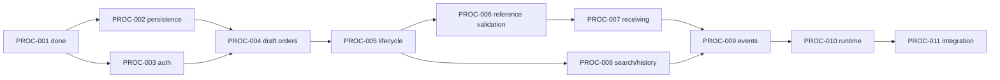

# Procurement Service — Delivery Plan for the Remaining Slices

> **Superseded:** the working sprint plan now lives in
> [`backend/services/Procurement/docs/plan/`](../../backend/services/Procurement/docs/plan/README.md).
> Keep this file as the high-level reference only.

Source of truth for scope: [`docs/scope/scope.md`](../scope/scope.md).
This plan turns PROC-002 → PROC-011 into an execution order with concrete files,
gates, and known blockers. It does not change the scope or acceptance criteria.

## Current position

| Slice | Status | Reality |
|---|---|---|
| PROC-001 Service foundation | in progress | Builds, starts, health/status endpoints, Dockerfile, hexagonal folders. Only evidence left is the Docker build/run check. |
| PROC-002 → PROC-011 | planned | Nothing implemented yet. |

The service currently runs with `DataSourceAutoConfiguration` and
`RabbitAutoConfiguration` excluded. JPA, Flyway, PostgreSQL, AMQP, and validation
dependencies are already declared in `build.gradle.kts`; they only need wiring.

## Working rules

1. One slice per branch/commit, named with its `PROC` ID.
2. A slice is done only when the service still builds and the slice tests pass.
3. No slice may depend on a later slice. If a later need appears, add the smallest
   forward-compatible hook.
4. Every slice ends with review evidence (commands + output) before commit.
5. External services that do not exist yet are developed against stubs/WireMock and
   a documented contract, then wired in PROC-011.

## Decisions to lock before writing code

These are load-bearing. Decide them once, record them in the README or an ADR, then
build against them.

| # | Decision | Recommendation | Why |
|---|---|---|---|
| D1 | Receiving consistency model | **Synchronous Inventory call with a persisted Pending receipt, plus bounded retry** (per PROC-007). Do not publish a receipt event that mutates stock. | Matches the scope; keeps receipt state visible and recoverable. |
| D2 | API surface and versioning | `/api/procurement/...`, no URL version yet; version events only. | Matches existing `/api/procurement/status` and the gateway routing convention. |
| D3 | Error contract | RFC 7807 `ProblemDetail` for all errors: `400`, `403`, `404`, `409`, `503`. | Consistent, testable, and avoids leaking internals. |
| D4 | Authorization model | Trusted gateway headers only (`X-User-Id`, `X-User-Roles`, `X-Correlation-Id`); reject missing context; no login inside Procurement. | Matches PROC-003 and FR-AUTH. |
| D5 | Pagination shape | `page`, `size`, stable sort by `createdAt DESC, id ASC`; response includes `content`, `page`, `size`, `totalElements`, `totalPages`. | Matches AC-004-7 / AC-008-5. |
| D6 | Event publication strategy | Post-commit publish with a persisted publication row and bounded retry (scope choice). Keep the publisher behind a port so a transactional outbox can replace it later. | Scope defers the outbox; the port keeps the migration cheap. |
| D7 | Purchase order API shape | Draft creation accepts supplier + lines; receipts are one line per request. | Matches AC-004-1 and AC-007-2. |

## Target API surface

```text
GET    /api/procurement/status

POST   /api/procurement/purchase-orders
GET    /api/procurement/purchase-orders
GET    /api/procurement/purchase-orders/{orderId}
PUT    /api/procurement/purchase-orders/{orderId}
POST   /api/procurement/purchase-orders/{orderId}/submit
POST   /api/procurement/purchase-orders/{orderId}/approve
POST   /api/procurement/purchase-orders/{orderId}/cancel

POST   /api/procurement/purchase-orders/{orderId}/receipts
GET    /api/procurement/purchase-orders/{orderId}/receipts
POST   /api/procurement/receipts/{receiptId}/retry
```

Search filters (PROC-008): `supplierId`, `status`, `createdFrom`, `createdTo`,
`page`, `size`.

## Delivery phases

### Phase 0 — Close PROC-001 (half a day)

- Run `./gradlew clean build`.
- Build and run the Docker image; capture `/actuator/health` and
  `/api/procurement/status` responses.
- Add the evidence to the README or the review notes.
- Mark PROC-001 `done` in `docs/scope/scope.md`.

**Gate:** build output, startup output, health response, Docker build output.

### Phase 1 — Foundation: PROC-002 (persistence) then PROC-003 (auth)

Do PROC-002 first; every later slice writes to the database.

**PROC-002 — Persistence and schema**

Files to add:

```text
src/main/resources/application.yml                 # datasource + JPA + Flyway config from env
src/main/resources/db/migration/V1__init.sql
domain/model/PurchaseOrder.java
domain/model/PurchaseOrderLine.java
domain/model/GoodsReceipt.java
domain/model/PurchaseOrderStatus.java
domain/model/ReceiptStatus.java
adapter/out/persistence/PurchaseOrderJpaEntity.java
adapter/out/persistence/PurchaseOrderLineJpaEntity.java
adapter/out/persistence/GoodsReceiptJpaEntity.java
adapter/out/persistence/*Repository.java
adapter/out/persistence/*Mapper.java
```

Schema requirements:

- UUID primary keys; `NUMERIC(19,3)` quantities; `TIMESTAMPTZ` timestamps.
- `purchase_orders`: supplier id, creator, status, timestamps, `version` for
  optimistic locking.
- `purchase_order_lines`: order FK, product id, ordered quantity `> 0`,
  received quantity `>= 0` and `<= ordered`.
- `goods_receipts`: order and line FKs, quantity, unique `idempotency_key`,
  status (`PENDING`, `APPLIED`, `FAILED`), inventory operation id, attempt count,
  last error, timestamps.
- `event_publications`: event id (unique), type, payload, status, attempts, last
  error, timestamps. Create it now so PROC-009 does not need a second migration.
- Check constraints for status values and quantity ranges.
- Remove the datasource exclusion from `application.yml`.

**Gate:** Flyway migrates an empty PostgreSQL database; constraint/integration test
covers duplicate idempotency keys and invalid quantities.

**PROC-003 — Gateway authorization boundary**

Files to add:

```text
config/SecurityConfig.java
adapter/in/web/security/GatewayHeaderFilter.java
adapter/in/web/security/UserContext.java
adapter/in/web/security/Role.java
adapter/in/web/security/AuthorizationRules.java
adapter/in/web/ProblemDetailExceptionHandler.java   # shared with later slices
```

Rules:

- Missing `X-User-Id` → `403`.
- `X-User-Roles` parsed from a comma-separated list; unknown roles ignored.
- `SYSTEM_ADMIN` gets no procurement business access by default.
- `MANAGER`: create/edit/approve/cancel.
- `STAFF`: submit and receive.
- Client-supplied identity headers cannot override the gateway values. Strip or
  reject duplicates; do not read identity from request bodies or query params.

**Gate:** role matrix tests for each endpoint, header spoofing test, example `403`
payloads.

### Phase 2 — Draft purchase orders: PROC-004

Build the first real vertical slice: controller → use case → domain → JPA.

```text
application/port/in/CreatePurchaseOrderUseCase.java
application/port/in/UpdatePurchaseOrderUseCase.java
application/port/in/GetPurchaseOrderUseCase.java
application/port/in/ListPurchaseOrdersUseCase.java
application/port/out/PurchaseOrderRepositoryPort.java
application/service/PurchaseOrderService.java
adapter/in/web/PurchaseOrderController.java
adapter/in/web/dto/*.java
domain/exception/*.java
```

Rules:

- Manager creates; creator or Manager edits; only `DRAFT` is editable.
- Reject missing supplier, empty lines, zero or negative quantities, duplicate
  product lines (decide: reject or merge — recommend reject with `400`).
- List is paginated with stable ordering.
- Return `201` with `Location` on create and `409`/`400` with `ProblemDetail` on
  failure.

**Gate:** controller tests, domain tests, validation tests, pagination test.

### Phase 3 — Lifecycle: PROC-005

- Implement the state machine in the domain: `DRAFT → SUBMITTED → APPROVED →
  PARTIALLY_RECEIVED → COMPLETED`, with `CANCELLED` reachable from `DRAFT`,
  `SUBMITTED`, `APPROVED`, and `PARTIALLY_RECEIVED`.
- `COMPLETED` and `CANCELLED` are terminal.
- Record acting user and UTC timestamp for every transition.
- `@Version` handles concurrent updates; map `OptimisticLockException` to `409`.
- Staff may submit; Manager only may approve/cancel.
- Invalid transition → `409`, no writes.

**Gate:** state-transition table test, role-specific endpoint tests, concurrent
update test.

### Phase 4 — External reference validation: PROC-006

**Blocker:** the Supplier and Product services do not exist as usable APIs. Build
against a documented contract and WireMock now; wire the real services in PROC-011.

```text
application/port/out/SupplierClientPort.java
application/port/out/ProductClientPort.java
adapter/out/client/SupplierHttpClient.java
adapter/out/client/ProductHttpClient.java
adapter/out/client/ClientConfiguration.java
docs/contracts/supplier-product.md        # request/response contract used by stubs
```

Rules:

- Validate supplier exists/active on create.
- Validate every product exists/active on create.
- Re-validate on submit, so a deactivated product cannot be submitted.
- Missing record → business error (`400`/`422`), no order created or changed.
- Timeout → `503`, no partial write.
- Base URLs and timeouts from environment (`PROCUREMENT_SUPPLIER_URL`,
  `PROCUREMENT_PRODUCT_URL`, connect/read timeout).
- Use Spring `RestClient` with explicit connect and read timeouts.

**Gate:** WireMock tests for success, 404, inactive, timeout, and 503 mapping.

### Phase 5 — Goods receiving: PROC-007 (highest-risk slice)

Do this after PROC-006 because receiving reuses the Inventory-style client pattern.

Files:

```text
application/port/in/ReceiveGoodsUseCase.java
application/port/in/RetryReceiptUseCase.java
application/port/out/InventoryClientPort.java
application/port/out/ReceiptRepositoryPort.java
application/service/ReceivingService.java
adapter/out/client/InventoryHttpClient.java
adapter/out/persistence/...ReceiptRepository.java
adapter/out/messaging/... (none yet; events are PROC-009)
config/ReceiptRetryScheduler.java
```

Flow (per D1):

1. Require `Idempotency-Key`; `400` when absent.
2. In one transaction, create `PENDING` receipt and reserve the received quantity
   against the order line (guard: `received + quantity <= ordered`).
3. Commit, then call Inventory synchronously with the **receipt ID** as the
   idempotency key.
4. Inventory success → mark `APPLIED`, update line/order status
   (`PARTIALLY_RECEIVED`/`COMPLETED`).
5. Inventory technical failure/timeout → keep `PENDING`, return `202`.
6. Inventory business rejection → mark `FAILED`, do not change received quantity.
7. Repeating the same `Idempotency-Key` returns the original result, no second
   stock addition.
8. Retry scheduler retries `PENDING` receipts with bounded attempts and backoff,
   retaining the last failure; expose `POST /receipts/{id}/retry` for manual retry.
9. Concurrency: optimistic locking plus the quantity guard prevents over-receiving.

**Blocker:** the Inventory service does not exist. Document the expected contract
(`POST /api/inventory/...` with an idempotency key) in
`docs/contracts/inventory.md`, implement against WireMock, and replace the stub in
PROC-011. Do not invent a private database write.

**Gate:** duplicate request test, over-receipt test, timeout/202 test, retry test,
partial and complete receiving test, concurrent receipt test.

### Phase 6 — Search and history: PROC-008

- Add JPA Specifications or a query object for supplier, status, and date range.
- Validate `createdFrom <= createdTo`; invalid range → `400`.
- Paginate with total count and page metadata.
- Add `GET /purchase-orders/{id}/receipts` with stable ordering and pagination.
- Completed and cancelled orders remain queryable (no soft-delete).

**Gate:** filter examples, pagination tests, date-boundary tests.

### Phase 7 — Events and recovery: PROC-009

- Add event contracts with `eventId`, `type`, `occurredAt`, `schemaVersion`,
  aggregate ID, and business identifiers.
- Publish after the database transaction commits; write the publication row in the
  same transaction as the business change, then publish and mark it published.
- Enable RabbitMQ publisher confirms; configure exchanges/queues/routing keys from
  environment.
- Bounded retry with backoff; exhausted publications stay `FAILED` and inspectable.
- Log correlation IDs with every publish attempt.
- Remove the RabbitMQ exclusion from `application.yml`.
- Keep the publisher behind `ProcurementEventPublisherPort` so a transactional
  outbox can replace the strategy later.

**Gate:** event payload examples, RabbitMQ integration test (Testcontainers),
publish-failure/retry test, reconciliation test.

### Phase 8 — Runtime and integration: PROC-010, PROC-011

**PROC-010**

- Add `micrometer-registry-prometheus` and expose `health,info,prometheus`.
- Externalize DB, RabbitMQ, service URLs, and credentials; no secrets in Git.
- Add Kubernetes Deployment/Service manifests with resource limits, probes,
  non-root execution, and internal-only Service. The repo currently has no
  `deploy/` tree; create the Procurement manifests there.
- Add a local compose file for PostgreSQL/RabbitMQ (or document Testcontainers as
  the local path).
- Update the README with the full environment-variable table.

**PROC-011**

- Add Testcontainers PostgreSQL and RabbitMQ test dependencies.
- Full lifecycle test: create → submit → approve → receive (partial + complete) →
  query → inspect events.
- Authorization test for Manager, Staff, and System Administrator.
- Duplicate and concurrent receipt tests.
- Inventory outage/retry test.
- Event publication failure/recovery test.
- Run `./gradlew clean build` from a clean checkout and record the evidence.

## Dependency graph



PROC-003 can run in parallel with PROC-002 if there are two work streams. Keep them
on separate branches so each slice still reviews independently.

## Suggested schedule

| Week | Work | Outcome |
|---|---|---|
| 1 | Phase 0 + PROC-002 | Real PostgreSQL schema and repositories |
| 2 | PROC-003 + PROC-004 | Authorized draft order create/read/edit/list |
| 3 | PROC-005 + PROC-008 | Full lifecycle plus search/history |
| 4 | PROC-006 + contract docs | Validated supplier/product references |
| 5 | PROC-007 | Idempotent receiving with pending/retry semantics |
| 6 | PROC-009 + PROC-010 | Events, metrics, deployment manifests |
| 7 | PROC-011 | Testcontainers end-to-end verification |

This assumes one developer. If PROC-006/007 need real Supplier/Inventory services,
treat the contract + WireMock work as the deliverable and schedule the real wiring
as a separate integration task.

## Test strategy by slice

| Layer | Tool | Used by |
|---|---|---|
| Domain rules/state machine | Plain JUnit | PROC-004, 005, 007 |
| Web/controller | `@WebMvcTest` + MockMvc | PROC-003, 004, 005, 008 |
| Persistence | `@DataJpaTest` + Testcontainers PostgreSQL | PROC-002, 004, 008 |
| External clients | WireMock | PROC-006, 007 |
| Messaging | Testcontainers RabbitMQ | PROC-009 |
| End-to-end | `@SpringBootTest` + Testcontainers | PROC-011 |

Current tests are only `ServiceStatusControllerTest` and
`ProcurementApplicationTests`; expect the test suite to grow with each slice.

## Risks and mitigations

| Risk | Impact | Mitigation |
|---|---|---|
| Supplier, Product, and Inventory services do not exist | PROC-006/007 cannot be truly end-to-end | Contract-first + WireMock; real wiring in PROC-011 |
| Receiving flow spans two services | Double stock addition, lost receipts, over-receipt | Persist Pending receipt first, receipt ID as Inventory idempotency key, optimistic lock, retry with bounded attempts |
| Direct event publishing can lose events after commit | Downstream consumers miss `GoodsReceived` | Persist publication row in the transaction, retry, keep failed rows inspectable; keep outbox migration path |
| Scope uses Java but `documentation/file-structure.md` describes .NET | Reviewer confusion, wrong tooling assumptions | Add a short note to the Procurement README; align the docs in a separate change |
| No existing local infrastructure | Developers cannot run the service | Add compose for PostgreSQL/RabbitMQ or make Testcontainers the documented path |
| Large slices (PROC-004/007) | Long-lived branches and hard reviews | Split internally by layer but keep one PROC commit; review the API + tests first |

## Start here (first working session)

```bash
cd backend/services/Procurement

# 1. Confirm the baseline
./gradlew clean test

# 2. Start local PostgreSQL (or use Testcontainers in the first test)
docker run --rm -d --name procurement-pg \
  -e POSTGRES_DB=procurement_db \
  -e POSTGRES_USER=procurement \
  -e POSTGRES_PASSWORD=procurement \
  -p 5432:5432 postgres:16

# 3. Create the slice branch
git switch -c feat/proc-002-persistence

# 4. Implement, then verify
./gradlew clean test
```

Definition of done for the first session: `V1__init.sql` applies cleanly, the three
aggregates and their repositories load and save, duplicate idempotency keys are
rejected, and the datasource exclusion is gone.

## Immediate next actions

1. Confirm D1–D7 and write them into the Procurement README or a short ADR.
2. Close PROC-001 with Docker evidence.
3. Implement PROC-002.
4. Review the schema before starting PROC-004; changing it later is expensive.
5. Draft the Supplier/Product and Inventory contracts alongside PROC-006/007 so the
   stubs match what the real services will expose.
